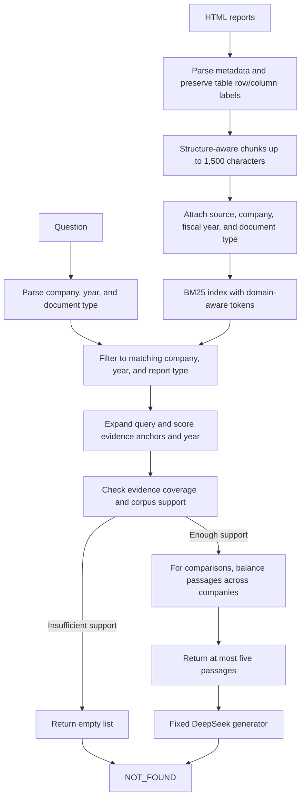

# FTEC5660 Homework 4

This repository implements the retrieval pipeline for the public company-report dataset and records a cumulative ablation study. The five assignment functions are in `hw4.py`; `ablation.py` reproduces the Task 5 variants and writes the summary and per-question results.

## Setup

Python 3.10 or newer is required. In PowerShell:

```powershell
py -3 -m venv .venv
.\.venv\Scripts\Activate.ps1
python -m pip install -r requirements.txt
Copy-Item .env.example .env
```

Set `DEEPSEEK_API_KEY` in `.env`. The file is ignored by Git. Run the assignment pipeline and the ablation with:

```powershell
python hw4.py --data-folder public_test
python ablation.py --data-folder public_test
```

The ablation runner sends model requests sequentially and caches identical question/context prompts in `ablation_answer_cache.json`. The cache is ignored by Git. It writes `ablation_summary.csv` and `ablation_details.csv` in the selected output directory. The model is `deepseek-v4-flash`, at temperature 0, with thinking disabled and `max_tokens=64`; the provided generator prompt and answer format remain fixed.

## Homework 4 solution

### Pipeline



The system extracts company, fiscal year, and document type from each report, converts every table value into text tied to its row and column labels, and splits the resulting document while preserving its sections and required metadata. It indexes those chunks with lexical BM25, parses each question, and filters candidates by company, year, and report type before ranking with finance-related query expansions and evidence/year matches. For comparisons, retrieval allocates passages across the named companies; a coverage check returns no passages when the corpus lacks a company or enough evidence for the requested fact. The provided generator then answers only from up to five retrieved passages, or returns `NOT_FOUND` when retrieval returns an empty list.

### Ablation design and results

The public set contains 40 HTML documents and 60 questions: 46 answerable and 14 unanswerable. All rows use the same generator. B0 follows the handout's naive baseline: `BeautifulSoup.get_text()`, the default `RecursiveCharacterTextSplitter`, required metadata, lowercase whitespace tokens, default `rank_bm25` parameters (`k1=1.5`, `b=0.75`), whole-corpus top-5, and no abstention. Each later row carries forward the previous row and adds one component. `V10` uses the submitted retrieval implementation.

| Variant | Added component | Table score | Chunk pass | Query parse | Valid top-5 | Recall@5 | Kept | Rejected | End-to-end accuracy | API calls |
|---|---|---:|---:|---:|---:|---:|---:|---:|---:|---:|
| B0 | Naive RAG baseline | 0.0% | 0.0% | — | 100.0% | 28.3% | 100.0% | 0.0% | 60.0% | 60 |
| V1 | Table serialization | 100.0% | 0.0% | — | 100.0% | 47.8% | 100.0% | 0.0% | 58.3% | 58 |
| V2 | Query parsing and metadata filters | 100.0% | 0.0% | 100.0% | 100.0% | 84.8% | 100.0% | 71.4% | 90.0% | 49 |
| V3 | Structure-aware chunking | 100.0% | 100.0% | 100.0% | 100.0% | 73.9% | 100.0% | 71.4% | 80.0% | 50 |
| V4 | Inline contextual header | 100.0% | 100.0% | 100.0% | 100.0% | 87.0% | 100.0% | 71.4% | 90.0% | 50 |
| V5 | Domain-aware tokenization | 100.0% | 100.0% | 100.0% | 100.0% | 82.6% | 100.0% | 71.4% | 86.7% | 47 |
| V6 | BM25 length normalization (`b=0.55`) | 100.0% | 100.0% | 100.0% | 100.0% | 80.4% | 100.0% | 71.4% | 86.7% | 12 |
| V7 | Query expansion | 100.0% | 100.0% | 100.0% | 100.0% | 97.8% | 100.0% | 71.4% | 98.3% | 31 |
| V8 | Evidence and year weighting | 100.0% | 100.0% | 100.0% | 100.0% | 97.8% | 100.0% | 71.4% | 98.3% | 21 |
| V9 | Balanced comparison retrieval | 100.0% | 100.0% | 100.0% | 100.0% | 100.0% | 100.0% | 71.4% | 100.0% | 11 |
| V10 | Evidence-based abstention | 100.0% | 100.0% | 100.0% | 100.0% | 100.0% | 100.0% | 100.0% | 100.0% | 0 |

`Table score` is the share of table cells preserved with their row and column labels. `Chunk pass` is the share of documents meeting the assignment's chunk size, metadata, and probe checks. `Query parse` averages the three parsed fields. `Valid top-5` is the share of answerable questions returning one to five corpus chunks. Recall@5 is over the 46 answerable questions; kept and rejected are measured over answerable and unanswerable questions, respectively. End-to-end accuracy is over all 60 questions. The CSV files contain full precision and per-question answers.

The first two changes address distinct failures. Table serialization raises table-cell score from 0% to 100% and Recall@5 from 28.3% to 47.8%; end-to-end accuracy dips slightly from 60.0% to 58.3% in this single run, so better recall did not automatically produce a better answer for every question. Metadata parsing and filtering then raise recall to 84.8% and reject 10 of 14 unanswerable questions. The default recursive splitter produces chunks longer than the assignment's 1,500-character limit, so B0 through V2 fail the chunk check; V3 fixes that check for every document. On this corpus, however, V3's new chunk boundaries lower recall to 73.9% and accuracy to 80.0%. Adding the inline metadata header in V4 recovers recall to 87.0%. Domain tokenization and the BM25 `b` change each reduce recall in this sequence, so neither showed a benefit here. Query expansion is the largest retrieval gain after filtering: V7 reaches 97.8% recall. Evidence weighting leaves aggregate scores unchanged, while balancing comparison retrieval brings both recall and accuracy to 100%. Abstention keeps all 46 answerable questions and rejects all 14 unanswerable ones.

### Error analysis

- In B0, q041 asks for cash held by Brightwater Mining, which is not in the corpus. Whole-corpus retrieval still supplies five passages, and the generator returns `363.2`; the answer is wrong. With no entity filter or abstention rule, similar names can produce confident false positives.
- In V7 and V8, q013 asks which of Brightwater Energy and Orchid Bay Hotels had higher FY2024 net income. The top five contain passages from Orchid Bay Hotels but none from Brightwater Energy, so the generator returns `NOT_FOUND`. V9's round-robin selection includes evidence for both companies and answers correctly. This is why a comparison needs coverage on both sides, not only a high-scoring passage for one company.
- The full pipeline's public-set `results.csv` has 60/60 correct answers, 46/46 answerable retrieval hits, 14/14 unanswerable questions rejected, and a 100% query-parse and valid-result rate. The final ablation row matches these public-set measurements.

The clean-cache ablation issued 389 generator API calls and took about 4 minutes 39 seconds across its variant runs. The cost estimate from the provided token counter and pricing constants is **$0.1737** for this final matrix; it excludes earlier exploratory runs. Identical prompts are cached across variants; V10 needed no new generator calls because its answerable prompts had already appeared in V9, while its unanswerable cases returned an empty retrieval result. This is one final run, not an average across repeated trials. In an exploratory rerun with reused answers, B0's end-to-end accuracy differed by one question from the clean-cache run despite temperature 0, so generation is not perfectly repeatable in this environment.

### Task 6 reflection

The English reflection is available as a [PDF](task6_reflection.pdf), with the [Markdown source](task6_reflection.md).\n\n